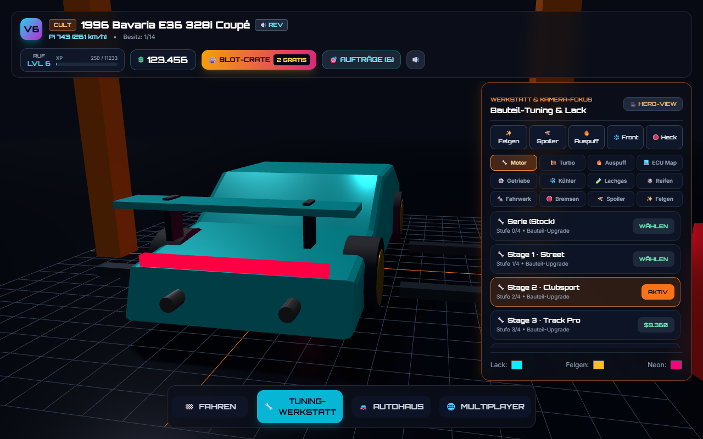

# Original presentation equivalence

The initial software-rendered preview has been replaced. Rust still owns
physics, progression, purchasing/tuning, challenge claims, crate draws and
settlement, UI action validation, saves and multiplayer state. The browser
adapter reuses the reviewed original visual/audio presentation, with the
original pinned Three.js r160 renderer served locally.

## Differential visual fixtures

Compared original commit `42a8aa98e19903d745b760ddac1a2c2b96d1c179` against the
Rust-controlled presentation in the same Chromium/software-WebGL environment,
at 1280×800, using identical save fixtures, fixed time and visual randomness.
Finite CSS transitions settle before capture. The original reference uses the
same local renderer/fonts/CSS instead of a live CDN; its original game logic
runs only on the test-only reference server, not in the new production client.

| Fixture | Mean absolute RGB error (0–255) | Pixels with channel error >12 |
|---|---:|---:|
| Garage / starter hatch | 0 | 0% |
| Tuning / E36 coupe | 0 | 0% |
| Moped + rider | 0 | 0% |
| TukTuk | 0 | 0% |
| Mower + driver | 0 | 0% |
| Hypercar | 0 | 0% |
| Dealership / wagon | 0 | 0% |
| SUV | 0 | 0% |
| GT3 | 0 | 0% |

The nine screenshots are **pixel-identical in these fixtures**. This does not
assert that every race frame, browser, GPU, audio output device or physical
phone is identical. Fixtures include owned cars/tuning as test data; they are
not evidence of earned progression. The separate browser play tests buy a
starter normally, drive, finish a race and settle a crate without save injection.

### Original versus Rust-controlled tuning

Original:

Rust-controlled presentation:

All nine original/Rust pairs and their numeric measurements are under
`docs/equivalence/`. Each fixture also compares cash, selected car, effective
stats, top speed and performance index.

Three additional **moving race** fixtures use the actual original controller
and the production WASM client, identical virtual time, save and keyboard
events. Straight acceleration, active drift and active nitro screenshots also
have zero RGB error and zero differing pixels. Their speed, NOS, yaw, position,
drift points, lap/sample and displayed time match exactly. These six screenshots
and measurements are under `docs/equivalence/race/`. Reproduce with
`node tools/race-visual-parity.cjs` and
`python tools/image-diff.py evidence/race-equivalence`.

## Restored presentation features

- Original starter cards, four-tab layout, stat bars, dealership delta previews,
  rarity badges, challenges, finish dialog and thirty-tile crate reel.
- Original wedge-shaped vehicle bodies, glass/metal materials, headlights,
  specialty moped/TukTuk/mower meshes and rider/driver details.
- Tuning-dependent suspension, rims, intercooler, spoiler and exhaust geometry;
  body/rim/neon colors, steering wheels, wheel spin and nitro flames.
- Original workshop floor/lift, tool trolley, tire stacks, neon lights and dust;
  camera presets and easing, road elevation/banking/materials/curbs/pylons,
  drift smoke/skids, speed lines, shake, field of view and SVG tachometer.
- Original procedural WebAudio synthesis implementation and vehicle profiles,
  tire noise, preview revs and tones. Audio synthesis code/profile preservation
  was checked; physical listening-device equivalence was not measured.

## Differential gameplay verification

The actual archived V6 controller generated 92 scenarios covering every car
on every track, throttle/coasting/braking/reverse, steering, handbrake drift,
nitro, AI movement, near misses, slipstream, offroad recovery, landing and
sample-wrap finishes. Automated drivers completed all 16 track/mode combinations.
Rust replayed the same inputs at the same 1/60-second time step for **194368
frames**, comparing speed, NOS, yaw, position, drift timing/points/combo, airborne
state, slipstream, stunt cash, laps, samples, ranks, AI progress/cooldowns,
challenge progress, finish cash, XP, levels and free spins.

All discrete values matched exactly. The largest measured floating-point error
was **5.684341886080802e-14**. Physics and road generation now use f64, as does
the original JavaScript number representation. The fixtures deliberately seed
some edge conditions; they are distinct from ordinary-input browser play tests.
Original source quirks are preserved: the simple sample-wrap lap rule, wrapped
AI ranking, no invented collision speed penalty, and finish-counting `p_wins`.
This rewrite does not silently redesign these mechanics.

Reports: [native replay](equivalence/gameplay-parity.json) and
[production WASM replay](equivalence/wasm-parity.json). Reproduce with
`node tools/gameplay-parity.cjs` against the reference server, then
`node tools/wasm-parity.cjs`. `node tools/replay-parity.cjs` reuses the generated
local fixtures. The WASM test drives the real exported client API through its
countdown and compares ordinary input traces; seeded edge cases stay in the
native replay.

The production WASM replay passed 72 scenarios / 191484 frames; its maximum
measured floating-point error was 2.842170943040401e-14. Discrete gameplay and
finish economy values match exactly. This evidence covers the listed tests;
it does not claim mathematical identity for every possible input or device.

## Deliberate differences

- The lobby uses the local Rust WebSocket relay, not the external PeerJS broker.
  Explicit connect/create/leave controls, up to eight drivers and host-only
  configuration/start are retained. It is not pixel-matched to the old lobby.
- Settlement is idempotent, inputs are bounded and invalid saves are normalized.
- Pause/reset controls are added. Replaced meshes and bounded skid resources
  are disposed to avoid the original preview-resource accumulation.
- The original desktop width/layout conventions are retained, including the
  source's full-width Drive panel when its nonstandard `sm:w-88` utility is not
  defined. The comparison does not silently redesign that original screen.

## Reproduction

Run the current game server on port 3123, then separately start the reviewed
test reference with `node tools/reference-server.cjs` (loopback port 3214).
With Playwright/Chromium available, export `evidence/roads.json` using the Rust
`roads` example, run `node tools/equivalence-compare.cjs`, then run
`python tools/image-diff.py` with Pillow/NumPy. `NOVA_COMPARE_CASE` optionally
reruns one named case; unset it for the complete suite. No test reference server
or upstream game controller runs during normal play.

`node tools/verify-vendor.cjs` checks committed renderer/font/style hashes offline.
Build-tool exceptions and security limits are in `SECURITY-REVIEW.md`.
