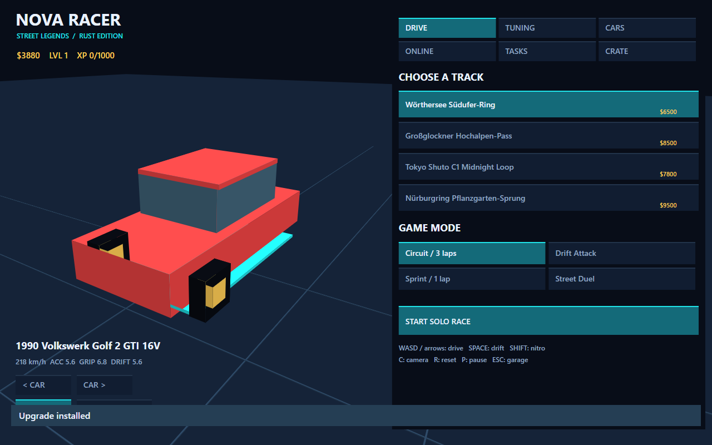
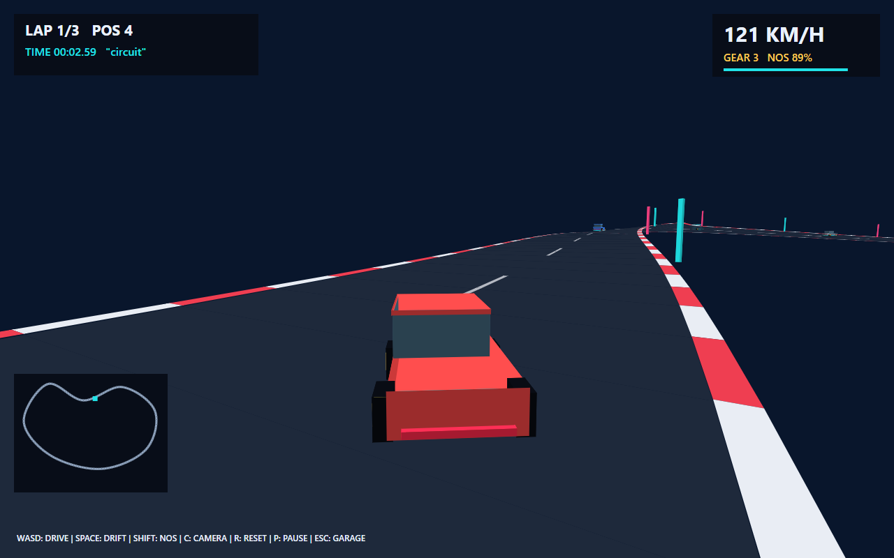
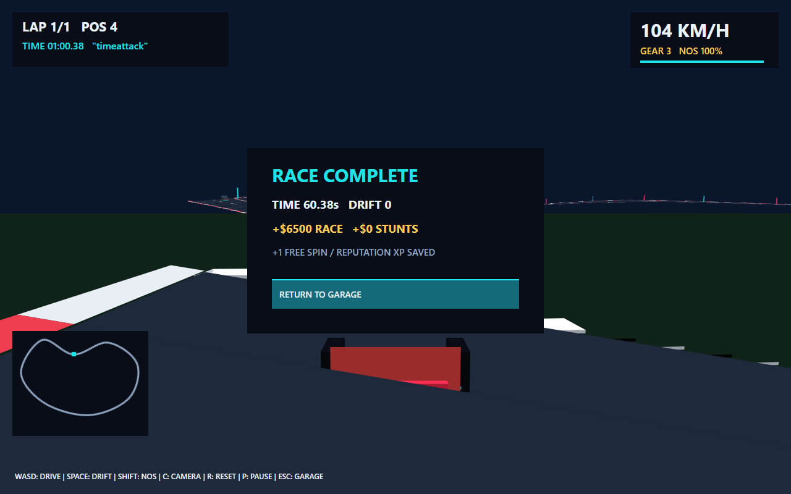

# Local validation

Tested on Windows x64 with Rust 1.97.0, a GNU linker, and Chromium through
Playwright. Both release targets build: `nova-server` and the `wasm32-unknown-unknown`
client. The generated WASM is approximately 520 KB and is built from source;
no opaque game executable is supplied in the PR.

| Check | Result |
|---|---|
| `cargo test --locked --workspace` | 11 tests passed |
| Core automated driver | All 16 track/mode combinations completed |
| `cargo fmt --all -- --check` | Passed |
| `cargo clippy --locked --workspace --all-targets -- -D warnings` | Passed |
| Release Rust server and WASM build | Passed |
| `cargo audit` | 0 vulnerabilities, no informational warnings |
| Live HTTP/WebSocket protocol | 14 checks passed |
| Ordinary browser UI/input/multiplayer | 8 checks passed |
| Full browser sprint | Finished in 60.38 seconds of simulated time |
| Finish settlement | $13500 after starter purchase/race; 480 XP; 1 free spin; no duplicate award |
| Browser network observations | Local game server only; no external executable assets |
| Browser exceptions | None in the tested scenarios |

The full browser sprint accelerates the animation clock while dispatching normal
keyboard events. It does not inject a finish flag, modify positions or change
the save. It exercises the compiled WASM game, its finish UI and localStorage.
The separate core driver also uses only normal throttle/brake/steering input.
The two-player check uses independent browser contexts, room creation/join,
host start and visible remote state in each client. Eight-player capacity is
verified at the protocol layer; eight simultaneous human players were not tested.

## Screenshots

Garage and the original track catalog:

Rust-generated 3D road and normal keyboard driving:

Finish screen after the browser driver completes a sprint:

These are automated local tests. Maintainer acceptance, production hosting,
physical devices, a human playtest and bounty payment are not implied by them.
The new renderer, UI and audio are reimplementations with the differences
documented in the README.
